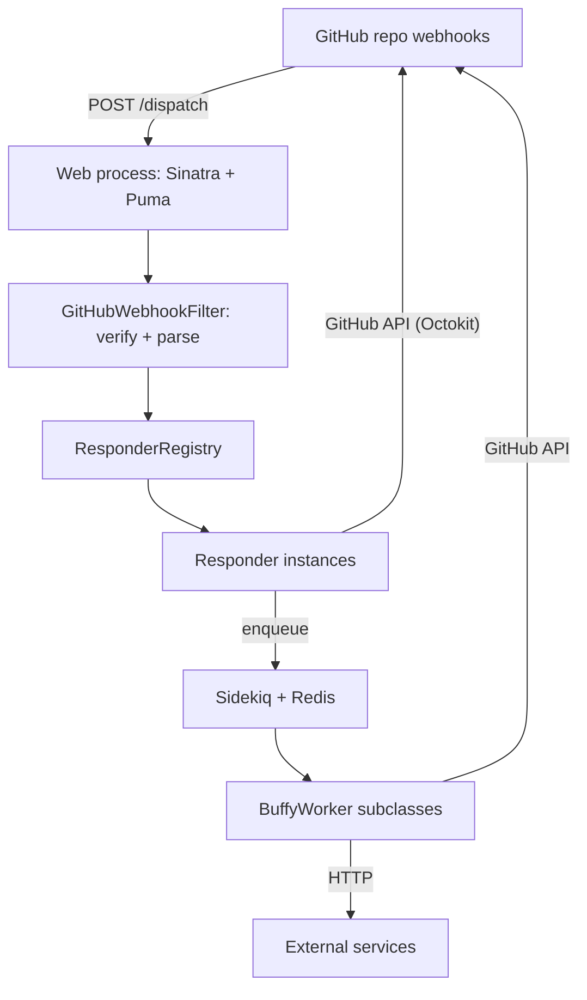

# Buffy — Codebase Wiki

Buffy is a configurable **chat-ops bot for managing peer review of software and papers on GitHub**. Deployed as a small Ruby web service, it listens to GitHub webhooks from a reviews repository and lets editors, reviewers, and authors drive the editorial process by posting commands such as `@bot assign @user as editor` or `@bot check references` in issue comments. It is used by communities like the Journal of Open Source Software, rOpenSci, pyOpenSci, and JuliaCon.

This wiki documents the codebase at source commit `f357243` (branch `main`). It is organized as an architecture section, one page per module, the key end-to-end flows, a concept glossary, and a few task guides. The upstream user and operator documentation lives in the repo's [`docs/`](https://github.com/ropensci-org/buffy/blob/main/docs/index.rst); this wiki summarizes and navigates the code rather than duplicating those docs.

## What this is

- **A Sinatra webhook receiver** — [app/buffy.rb](https://github.com/ropensci-org/buffy/blob/main/app/buffy.rb) exposes `POST /dispatch`, the single entry point for GitHub `issues` and `issue_comment` events.
- **A responder framework** — every bot behavior is a `Responder` subclass, declared in a YAML settings file and matched against incoming comments; see [Responder framework](architecture/responder-framework.md).
- **A background job system** — slow work (cloning repos, checking DOIs, calling external services, scheduled reminders) runs in Sidekiq workers; see [Background jobs](architecture/background-jobs.md).

## Architecture at a glance

The two deployment processes come from the [Procfile](https://github.com/ropensci-org/buffy/blob/main/Procfile): a `web` dyno running Puma and a `worker` dyno running Sidekiq. See [System overview](architecture/system-overview.md) for boundaries and design decisions.

## Navigation

### Architecture

- [System overview](architecture/system-overview.md) — boundaries, processes, and the request path
- [Responder framework](architecture/responder-framework.md) — how configured responders are loaded, matched, and run
- [Background jobs](architecture/background-jobs.md) — Sidekiq workers and why slow work is asynchronous

### Modules

- [Web app](modules/web-app.md) — the Sinatra app and webhook filter
- [Responder core](modules/responder-core.md) — the `Responder` base class, registry, and loader
- [Responders catalog](modules/responders-catalog.md) — the built-in responders under `app/responders/`
- [Workers](modules/workers.md) — the Sidekiq jobs under `app/workers/`
- [GitHub integration](modules/github-integration.md) — the Octokit wrapper, issue actions, and templating
- [Paper and DOI checks](modules/paper-doi.md) — BibTeX parsing, DOI validation, and repo utilities
- [Configuration](modules/configuration.md) — the settings YAML, teams, and environment variables

### Flows

- [Issue comment command](flows/issue-comment-command.md) — a user command travels from comment to bot reply
- [New submission](flows/new-submission.md) — what happens when a review issue is opened
- [Asynchronous repository check](flows/async-repo-check.md) — a responder hands work to a Sidekiq worker
- [Scheduled reminder](flows/reminder.md) — reminders fire later via scheduled workers

### Concepts

- [Responder](concepts/responder.md)
- [Buffy context](concepts/buffy-context.md)
- [Issue body markers](concepts/issue-body-markers.md)
- [External service](concepts/external-service.md)
- [Teams and authorization](concepts/teams-and-authorization.md)

### Guides

- [Add a custom responder](guides/add-a-responder.md)
- [Configure a command](guides/configure-a-command.md)
- [Run and test locally](guides/run-and-test-locally.md)

## Freshness

Generation and refresh runs are recorded in the [wiki log](log.md).