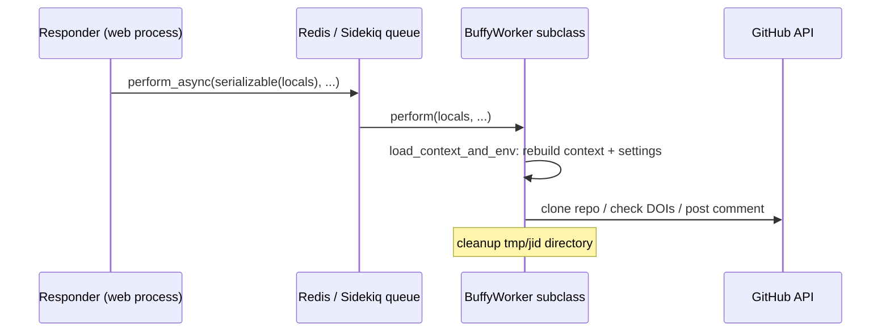

# Background jobs

## Summary

Anything slow — cloning the reviewed repository, parsing BibTeX, validating DOIs against doi.org and Crossref, calling external HTTP services — and anything scheduled — reminders — runs in **Sidekiq workers**, not in the web process. Responders enqueue jobs with plain-data payloads; the worker process (a separate dyno started with `bundle exec sidekiq -r ./app/lib/workers.rb`, per the [Procfile](https://github.com/ropensci-org/buffy/blob/main/Procfile)) picks them up and reports results back to the GitHub issue as comments.

## Diagram

## Key components

- **`BuffyWorker` base class** — [app/workers/buffy_worker.rb](https://github.com/ropensci-org/buffy/blob/main/app/workers/buffy_worker.rb). Includes `Sidekiq::Worker` plus the same `GitHub`, `Actions`, and `Templating` modules responders use, so workers can comment and edit issues with the same helpers. `load_context_and_env` rebuilds the [Buffy context](../concepts/buffy-context.md) from the serialized job payload and re-reads `config/settings-<environment>.yml` from disk. `setup_local_repo` clones the target repository into `tmp/<job-id>` and checks out the requested branch; `cleanup` removes it.
- **Worker loading** — [app/lib/workers.rb](https://github.com/ropensci-org/buffy/blob/main/app/lib/workers.rb) requires the base class then every file in `app/workers/`.
- **The concrete workers** — see [Workers](../modules/workers.md): `DOIWorker`, `RepoChecksWorker`, `ExternalServiceWorker`, `ReviewReminderWorker`, `AsyncMessageWorker`.
- **Serialization boundary** — responders call `serializable` ([app/lib/responder.rb](https://github.com/ropensci-org/buffy/blob/main/app/lib/responder.rb)) to convert settings/locals into plain JSON-able hashes before enqueueing, since Sidekiq payloads cross a process boundary.

## Design decisions

- **No retries.** `sidekiq_options retry: false` on `BuffyWorker`: a failed check reports an error to the issue (or just fails) rather than repeatedly re-commenting on a review thread.
- **Workers re-read configuration.** Because jobs run outside the web process, each job loads the settings YAML itself rather than sharing memory with Sinatra.
- **Self-contained payloads.** Jobs carry everything needed (repo, issue id, sender, data pulled from the issue body) so no shared state is required between web and worker.
- **Scheduled jobs for reminders.** `ReviewReminderWorker.perform_at` and `AsyncMessageWorker.perform_at` use Sidekiq's scheduled set; both no-op when the issue has since closed. See [Scheduled reminder flow](../flows/reminder.md).

## Related

- [System overview](system-overview.md) — where the worker process sits
- [Workers module](../modules/workers.md) — each worker's contract
- [Asynchronous repository check flow](../flows/async-repo-check.md)
- [External service concept](../concepts/external-service.md)