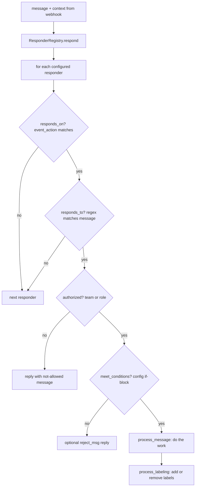

# Responder framework

## Summary

Every Buffy behavior is a **[Responder](../concepts/responder.md)**: a Ruby class that declares which GitHub event and which message pattern it listens to, who may invoke it, and what it does. The framework has three pieces: a loader mixed into the Sinatra app ([app/lib/responders_loader.rb](https://github.com/ropensci-org/buffy/blob/main/app/lib/responders_loader.rb)), a registry that builds responder instances from the settings file ([app/lib/responder_registry.rb](https://github.com/ropensci-org/buffy/blob/main/app/lib/responder_registry.rb)), and the `Responder` base class ([app/lib/responder.rb](https://github.com/ropensci-org/buffy/blob/main/app/lib/responder.rb)) that implements the dispatch pipeline every subclass inherits.

## Diagram

## Key components

- **`Responder` base class** — [app/lib/responder.rb](https://github.com/ropensci-org/buffy/blob/main/app/lib/responder.rb). Subclasses override `define_listening` (to set `event_action` and `event_regex`) and `process_message`. The inherited `call` method runs the pipeline: `responds_on?` → `responds_to?` → `authorized?` → `meet_conditions?` → `process_message`. It mixes in `Actions`, `Authorizations`, `Defaults`, `GitHub`, `Templating`, and `Logging`.
- **Class registration by `keyname`** — each subclass declares a `keyname` (e.g. `assign_editor`); `ResponderRegistry.available_responders` maps those keys to classes by scanning `app/responders/**/*.rb`.
- **Config-driven instantiation** — `load_responders!` walks the `responders:` node of the settings file. A responder key maps either to a params hash (single instance) or to an array of named instances (e.g. several `set_value` responders named `version`, `archive`, ...), each becoming one object.
- **Wrong-command fallback** — after all responders run, `respond` calls `reply_for_wrong_command` when no comment-command responder's regex matched the message, so users get a helpful reply to mistyped commands.
- **Help generation** — the `HelpResponder` reinstantiates the registry and asks each non-hidden responder for its `description` and `example_invocation`, so the `@bot help` reply always reflects the live configuration.

## Design decisions

- **Regexes as the command language.** A responder's `event_regex` defines its command syntax (e.g. `/\A@bot assign (\S+) as editor/i`); capture groups become `match_data` and are exposed to templates as `match_data_1`, `match_data_2`, ....
- **Two-axis authorization.** `only:` restricts to configured GitHub teams; `authorized_roles_in_issue:` restricts to users named in issue-body fields (e.g. the assigned editor). Both are optional; see [Teams and authorization](../concepts/teams-and-authorization.md).
- **Declarative preconditions.** The `if:` block (`title`, `body`, `value_exists`, `role_assigned`, `value_matches`, `labels`) gates execution without subclass code, with an optional `reject_msg` reply.
- **Labels as side effects.** Any responder can declare `add_labels` / `remove_labels`; `process_labeling` applies them after `process_message`, keeping labeling policy in configuration.
- **Errors are contained.** The registry wraps each `responder.call` in a begin/rescue and logs, so one failing responder never blocks the others.

## Related

- [Responder core module](../modules/responder-core.md) — file-by-file tour
- [Responders catalog](../modules/responders-catalog.md) — the built-in responders
- [Issue comment command flow](../flows/issue-comment-command.md) — the pipeline in action
- [Add a custom responder](../guides/add-a-responder.md)