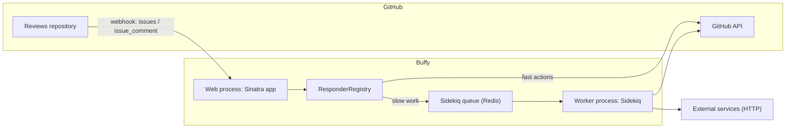

# System overview

## Summary

Buffy is a small Ruby service that turns GitHub activity into editorial automation for software peer review. A reviews repository (one per journal or community) sends GitHub webhooks to Buffy; Buffy matches each event against a set of configured **responders** and acts on the issue — replying, labeling, editing the issue body, assigning users — through the GitHub API. Everything a given journal's bot can do is declared in a YAML settings file, so the same codebase serves many journals without code changes.

The system has two runtime processes, defined in the [Procfile](https://github.com/ropensci-org/buffy/blob/main/Procfile): a **web** process (Puma serving the Sinatra app) and a **worker** process (Sidekiq), connected by a Redis queue. There is no database: persistent state lives in the GitHub issue body itself, inside HTML comment markers (see [Issue body markers](../concepts/issue-body-markers.md)).

## Diagram

## Key components

- **Sinatra app** — [app/buffy.rb](https://github.com/ropensci-org/buffy/blob/main/app/buffy.rb) mounts `POST /dispatch` (the single webhook entry point), plus `/status` and `/` health endpoints. Loads per-environment settings via `sinatra/config_file` from `config/settings-<environment>.yml`.
- **Webhook filter** — [app/sinatra_ext/github_webhook_filter.rb](https://github.com/ropensci-org/buffy/blob/main/app/sinatra_ext/github_webhook_filter.rb) runs before `/dispatch`: verifies the webhook signature, discards the bot's own comments, accepts only `issues` and `issue_comment` events, and builds the [Buffy context](../concepts/buffy-context.md). See [Web app](../modules/web-app.md).
- **ResponderRegistry** — [app/lib/responder_registry.rb](https://github.com/ropensci-org/buffy/blob/main/app/lib/responder_registry.rb) instantiates one [Responder](../concepts/responder.md) object per entry in the settings file and fans each incoming message out to all of them. See [Responder core](../modules/responder-core.md).
- **Responders** — [app/responders/](https://github.com/ropensci-org/buffy/blob/main/app/responders) holds the built-in behaviors (assign editor, manage reviewer lists, run checks, reminders, ...). See the [Responders catalog](../modules/responders-catalog.md).
- **GitHub integration** — [app/lib/github.rb](https://github.com/ropensci-org/buffy/blob/main/app/lib/github.rb) wraps Octokit with a memoized client and one method per API operation. See [GitHub integration](../modules/github-integration.md).
- **Workers** — [app/workers/](https://github.com/ropensci-org/buffy/blob/main/app/workers) Sidekiq jobs for slow or scheduled work: repository checks, DOI validation, external HTTP calls, reminders. See [Workers](../modules/workers.md) and [Background jobs](background-jobs.md).
- **Configuration** — [config/settings-test.yml](https://github.com/ropensci-org/buffy/blob/main/config/settings-test.yml) shows the shape: `env`, `teams`, and `responders` nodes. See [Configuration](../modules/configuration.md).

## Design decisions

- **One endpoint, regex routing.** All GitHub events arrive at `/dispatch`; routing to behaviors happens inside the responder framework via per-responder regexes rather than HTTP routes. This keeps the HTTP layer trivial and makes behaviors purely configuration-driven.
- **No database.** Review state (assigned editor, reviewer list, version, ...) is stored in the issue body between HTML comment markers, read and written through the GitHub API. Buffy instances are therefore stateless and disposable.
- **Fast path / slow path split.** Webhook handling must return quickly, so anything involving git clones or third-party HTTP calls is pushed to [Sidekiq workers](background-jobs.md); the web process only enqueues.
- **Webhook verification at the edge.** The signature check and bot-self-filtering happen in a Sinatra `before` filter, before any responder logic runs.
- **Configuration over code.** Journals fork/extend by editing YAML and, optionally, dropping custom responder classes into `app/responders/` (see [Add a custom responder](../guides/add-a-responder.md)).

## Related

- [Responder framework](responder-framework.md) — the matching/authorization pipeline
- [Background jobs](background-jobs.md) — the worker side of the split
- [Issue comment command flow](../flows/issue-comment-command.md) — the main request lifecycle
- [New submission flow](../flows/new-submission.md) — the `issues.opened` path