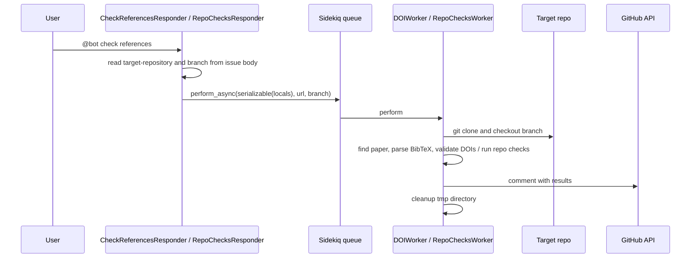

# Asynchronous repository check

## Summary

Repository-dependent commands — `@bot check references`, `@bot check repository`, and welcome-triggered checks — cannot run inside the webhook request because they clone the submitted repository and call third-party APIs. The responder enqueues a Sidekiq job; a worker clones the repo, runs the checks, and comments the results on the issue.

## Trigger

A comment command such as `@bot check references` (`CheckReferencesResponder`) or `@bot check repository` (`RepoChecksResponder`), or a [new submission](new-submission.md) welcome with checks enabled.

## Sequence diagram

## Steps

1. **Parse the command.** The responder's regex optionally captures a branch name; the target repository URL is read from the issue body's `target-repository` [marker](../concepts/issue-body-markers.md) (overridable via `url_field`).
2. **Enqueue.** The responder serializes `locals` (issue id, repo, sender, plus any `data_from_issue` fields) and calls `perform_async`.
3. **Rebuild state in the worker.** `BuffyWorker#load_context_and_env` recreates the [context](../concepts/buffy-context.md) and reloads the settings file; `setup_local_repo` clones into `tmp/<job-id>` and checks out the branch, commenting an error and aborting if either fails.
4. **Run the checks.** `DOIWorker` parses the paper's bibliography with [PaperFile and DOIChecker](../modules/paper-doi.md) and replies with the rendered `doi_checks` template; `RepoChecksWorker` runs the configured subset of cloc summary, language detection (as labels), wordcount, license detection, and statement-of-need detection.
5. **Report and clean up.** Results are posted as issue comments through the shared [GitHub integration](../modules/github-integration.md) helpers; the temporary clone is deleted.

## Related

- [Background jobs](../architecture/background-jobs.md) — why this is asynchronous
- [Workers](../modules/workers.md) and [Paper and DOI checks](../modules/paper-doi.md)