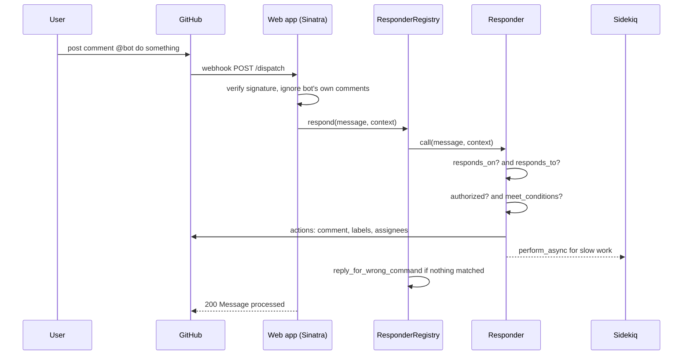

# Issue comment command

## Summary

This is Buffy's core flow: someone comments on a review issue with a command like `@bot assign @user as editor`, and the bot verifies, matches, authorizes, executes, and replies — usually within the single webhook request. Slow side effects are deferred to [background jobs](../architecture/background-jobs.md).

## Trigger

A user posts a comment mentioning the bot on an issue in the reviews repository; GitHub sends an `issue_comment.created` webhook to `POST /dispatch`.

## Sequence diagram

## Steps

1. **Receive and verify.** The [webhook filter](../modules/web-app.md) checks the signature against the configured secret, drops the bot's own `issue_comment` events, and accepts only `issues` / `issue_comment` events. Failures halt with the parser's error status.
2. **Build message and context.** The [Buffy context](../concepts/buffy-context.md) (repo, issue id, sender, event action, ...) and the message (comment body) are set on the request.
3. **Dispatch.** `ResponderRegistry#respond` calls every configured [responder](../concepts/responder.md) in turn; errors in one responder are logged and do not affect the others.
4. **Match and run.** Each responder runs its pipeline — `responds_on?`, `responds_to?`, `authorized?`, `meet_conditions?` — then `process_message`. Unauthorized senders get a polite refusal naming the authorized teams/roles; unmet conditions can send a configured `reject_msg`.
5. **Act.** The responder uses the [GitHub integration](../modules/github-integration.md) helpers to comment, label, edit the issue body, or manage assignees; it may enqueue a [worker](../modules/workers.md) or chain another responder via `process_other_responder`.
6. **Fallback.** If the message matched no comment-command responder, the registry invokes `WrongCommandResponder` so the user gets feedback.

## Related

- [Responder framework](../architecture/responder-framework.md) — the pipeline design
- [Responder core](../modules/responder-core.md) and [Responders catalog](../modules/responders-catalog.md)
- [Teams and authorization](../concepts/teams-and-authorization.md)
- [Configure a command](../guides/configure-a-command.md)