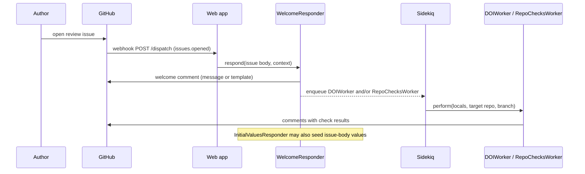

# New submission

## Summary

When a new review issue is opened, GitHub sends an `issues.opened` webhook. Event-based responders — most importantly `WelcomeResponder` and `InitialValuesResponder` — fire without any command: they greet the author, seed issue-body values, and can immediately kick off repository and reference checks on the submitted software.

## Trigger

An `issues.opened` webhook from the reviews repository (a new submission issue created).

## Sequence diagram

## Steps

1. **Event matching.** The [webhook filter](../modules/web-app.md) passes the issue body as the message; responders with `event_action = issues.opened` (and no `event_regex`) respond unconditionally.
2. **Initial values.** `InitialValuesResponder` ([app/responders/initial_values_responder.rb](https://github.com/ropensci-org/buffy/blob/main/app/responders/initial_values_responder.rb)) writes configured key/value pairs into the issue body as [issue body markers](../concepts/issue-body-markers.md), so later commands can read them.
3. **Welcome.** `WelcomeResponder` ([app/responders/welcome_responder.rb](https://github.com/ropensci-org/buffy/blob/main/app/responders/welcome_responder.rb)) posts configured messages or renders an external template from the reviews repo; it can call an [external service](../concepts/external-service.md) and close the issue when so configured.
4. **Automated checks.** If `check_references` or `repo_checks` are enabled and the issue body contains a `target-repository` value, the welcome responder enqueues `DOIWorker` / `RepoChecksWorker` — see [Asynchronous repository check](async-repo-check.md).
5. **Chaining and labels.** `run_responder` can invoke other configured responders inline, and `process_labeling` applies any configured labels.

## Related

- [Responders catalog](../modules/responders-catalog.md)
- [System overview](../architecture/system-overview.md)
- [Issue body markers](../concepts/issue-body-markers.md)