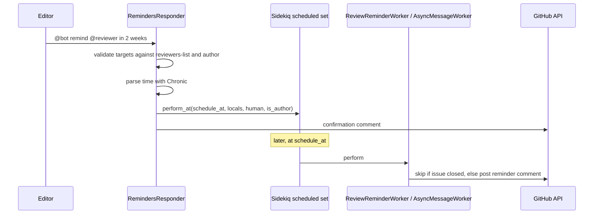

# Scheduled reminder

## Summary

Editors can ask the bot to nudge reviewers or authors later: `@bot remind @reviewer in 2 weeks`. The `RemindersResponder` validates the targets against the submission's author/reviewer lists, parses the time expression, and schedules one worker per person. When the job fires, it comments on the issue — unless the issue has since closed.

## Trigger

A comment matching `@bot remind <someone> in <n> <unit>` on a review issue.

## Sequence diagram

## Steps

1. **Match and parse.** The responder regex captures humans, amount, and unit; `chronic`-style parsing (`target_time`) converts it to a timestamp. Unparseable times get an explanatory reply.
2. **Validate targets.** Reviewers and authors may only set reminders for themselves; every target must appear in the issue's `reviewers-list`, be the author, or be the sender — see [issue body markers](../concepts/issue-body-markers.md) for how those lists are stored.
3. **Schedule.** Each target gets a job: `AsyncMessageWorker` for the sender, `ReviewReminderWorker` (with an `is_author` flag selecting the message text) for others. The responder immediately confirms the reminder.
4. **Fire.** The worker reloads context, checks the issue is still open, and posts the reminder; closed issues are skipped silently.

## Related

- [Workers](../modules/workers.md)
- [Background jobs](../architecture/background-jobs.md)
- [RemindersResponder source](https://github.com/ropensci-org/buffy/blob/main/app/responders/reminders_responder.rb)